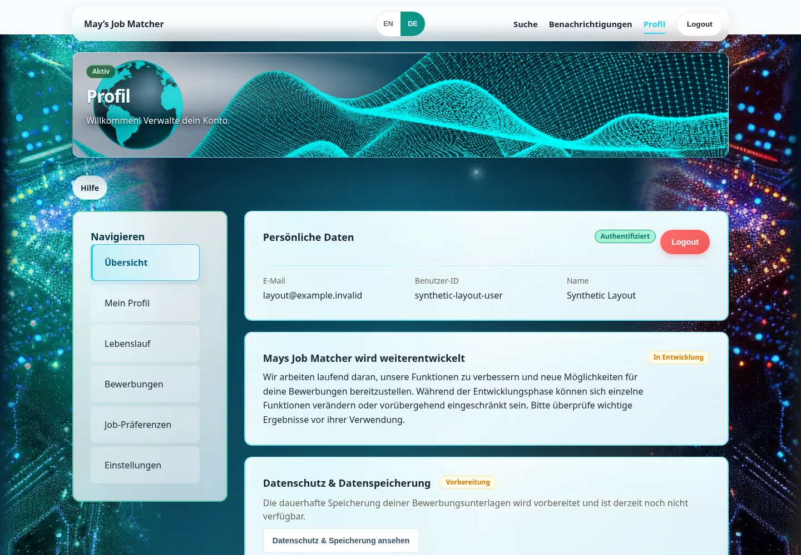
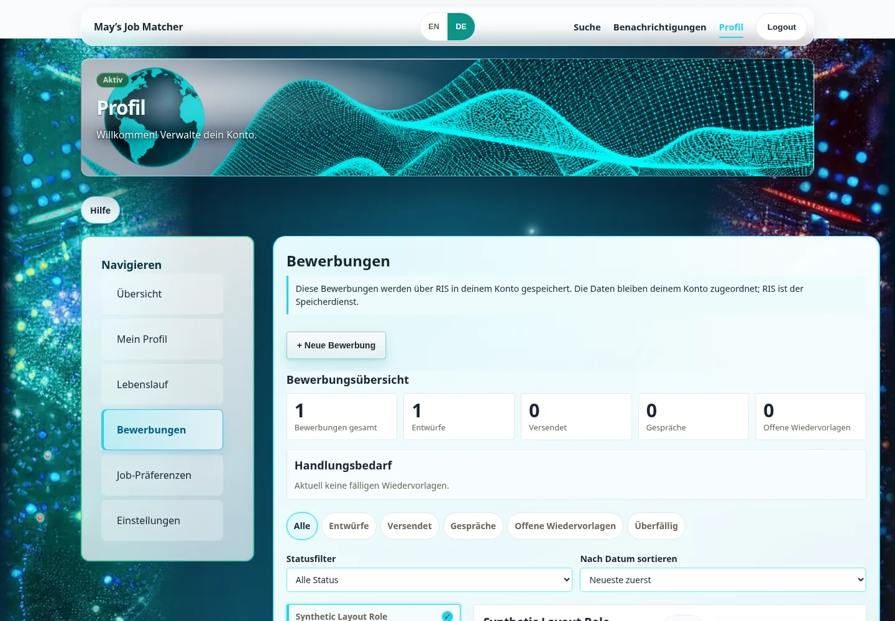
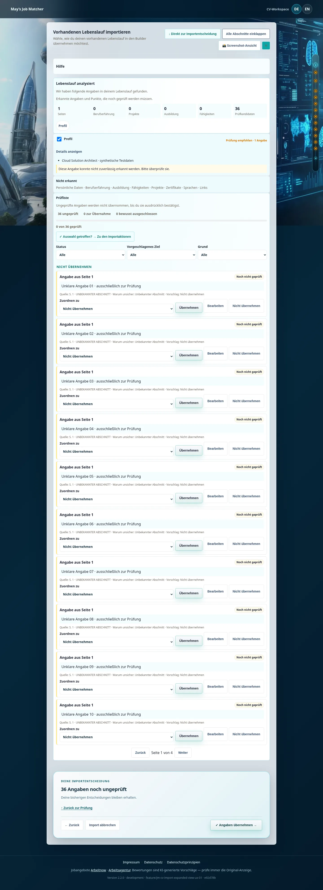
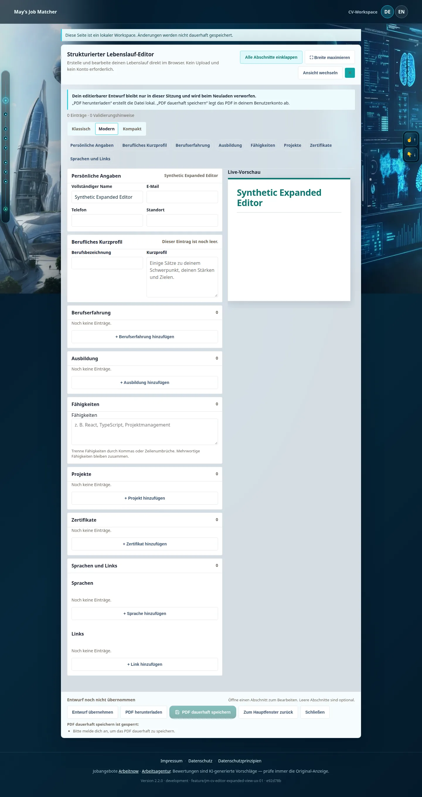
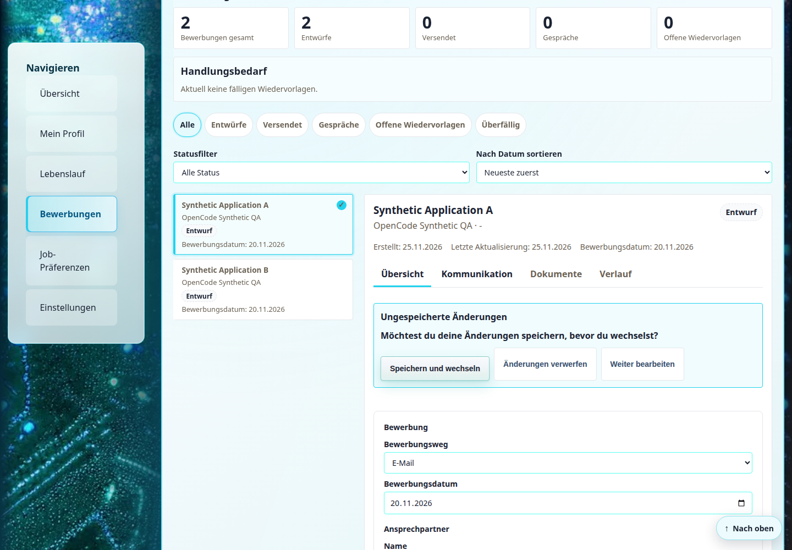
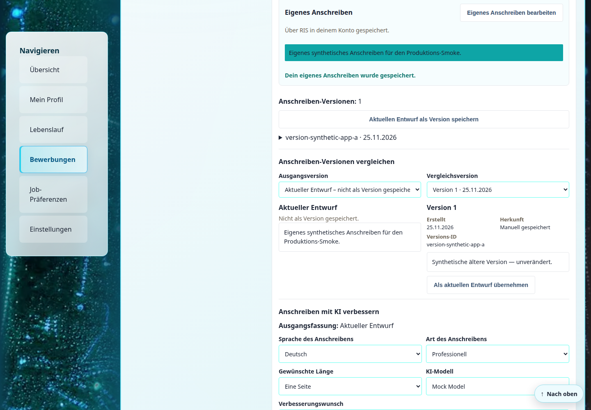

# May's Job Matcher

**Jobsuche, Matching und Bewerbungsverwaltung mit nachvollziehbarer KI-Unterstützung.**

May's Job Matcher bündelt Stellensuche, KI-gestütztes Matching, Bewerbungsverwaltung
und einen strukturierten Lebenslauf-Workspace in einer Anwendung. Die App läuft als
React-Frontend auf Vercel; alle KI-, Quellen- und RIS-Zugriffe laufen über
serverseitige BFF-Funktionen. API-Schlüssel und Partner-Credentials bleiben
serverseitig.

- **Production:** [www.mays-job-matcher.app](https://www.mays-job-matcher.app/)
- **Zweite Production-Domain:** [mays-jobsearch.vercel.app](https://mays-jobsearch.vercel.app/)
- **Aktueller Production-Stand:** `df1fe01` (`Version 2.2.0 · production · main`)
- **Repository:** [maynowak/mays-jobsearch](https://github.com/maynowak/mays-jobsearch)

> KI-Ergebnisse sind Vorschläge. Prüfe Bewertungen, Anschreiben und importierte
> CV-Daten immer an der Originalanzeige bzw. am eigenen Dokument.

---

## Screenshots

| Profilübersicht | Bewerbungsverwaltung |
| --- | --- |
|  |  |

| CV-Import mit Radar | Strukturierter CV-Editor |
| --- | --- |
|  |  |

| Ungespeicherte Änderungen | Eigenes Anschreiben |
| --- | --- |
|  |  |

Alle Screenshots stammen aus synthetischen Browser-Tests und enthalten keine
echten Kontodaten.

---

## Funktionsübersicht

### Jobsuche und Matching

- Live-Stellen von **Arbeitnow** und **Arbeitsagentur über Apify**.
- Suche nach Fähigkeiten, Zielrolle, Ort, Umkreis, Arbeitsmodell und Arbeitszeit.
- Keyword-Vorauswahl, danach KI-Bewertung von maximal zehn Kandidaten.
- Top-5-Ergebnisse mit Score, Begründung und Vorbereitungsfrage; weitere Treffer
  lassen sich lokal ohne zweiten Request einblenden.
- Match-Radar zur Navigation durch die Ergebnisliste.

### Profilverwaltung

- Profil-Dashboard mit sechs Bereichen: **Übersicht**, **Mein Profil**,
  **Lebenslauf**, **Bewerbungen**, **Job-Präferenzen**, **Einstellungen**.
- Stabile Profil-Shell: Header und Sidebar bleiben beim Bereichswechsel an
  derselben Position; die Bewerbungsverwaltung nutzt eine breitere
  Arbeitsfläche.
- Mobile Navigation über einen Bereichs-Switcher.

### Bewerbungsverwaltung

- Bewerbungsentwürfe aus einer Stellenanzeige oder manuell anlegen.
- Übersicht, Suche, Filter, Sortierung, Statusverlauf und Wiedervorlagen.
- Bearbeitungsdialog mit echtem Dirty-State-Vergleich:
  unverändert → sofortiger Wechsel; geändert → **Speichern und wechseln**,
  **Änderungen verwerfen** oder **Weiter bearbeiten**.
- Speicherfehler erhalten alle Eingaben und den Dialog; Erfolg wird erst nach
  bestätigter Speicherung angezeigt.
- Session- oder RIS-Konto-Speicherung, abhängig von Login, Capability und
  Einwilligung.
- Bewerbungsexport und Löschung.

### Eigene Anschreiben und KI-Unterstützung

- **Eigenes Anschreiben:** Text direkt schreiben oder bearbeiten, mit Vorschau
  und explizitem Speichern. Dabei wird **keine KI** aufgerufen und **keine neue
  Anschreibenversion** erzeugt.
- **KI-Anschreiben:** Der bestehende Assistent kann ein Anschreiben generieren,
  vergleichen und als Version speichern. Die KI-Ausgabe bleibt ein Vorschlag.
- Bestehende Anschreibenversionen bleiben bei Änderungen am eigenen Text
  unverändert.

### CV-Import und strukturierter CV-Editor

- PDF-Import im Browser: Das PDF wird **nicht hochgeladen**; die Textextraktion
  erfolgt lokal mit `pdfjs-dist`.
- Importvorschau mit erkannten Abschnitten, Prüfkandidaten, manuellen
  Zuordnungen, Filtern und Pagination.
- **Alle Abschnitte aufklappen/einklappen** mit sichtbarem Radar.
- **Screenshot-Ansicht** für eine störungsfreie Darstellung ohne Radar und
  schwebende Bedienelemente; beim Verlassen wird der vorherige Zustand
  wiederhergestellt.
- Strukturierter CV-Editor mit acht Abschnitten, Live-Vorschau, drei Templates,
  Validierung und PDF-Export.
- **Radar** und **Turbo-Hände** unterstützen Navigation und Scrollen; beide
  bleiben bei aufgeklappten Abschnitten verfügbar.

### Speicherung: Session versus RIS

| Modus | Verhalten |
| --- | --- |
| Session | Daten bleiben im Arbeitsspeicher der aktuellen Sitzung und gehen bei einem Reload verloren. |
| RIS-Konto | Dauerhafte Speicherung über die serverseitige RIS-BFF, nur nach Login, serverseitiger Testfreigabe und passender Einwilligung. |

Die App entscheidet nicht allein anhand eines UI-Flags: Der Browser prüft die
Remote-Capability über die BFF; fehlende oder abgelehnte Berechtigungen halten
die App im Session-Modus. Session-Daten werden nicht automatisch in das Konto
übertragen.

### Datenschutz und Einwilligungen

- Separate Einwilligungen für Anwendungs-, CV- und Suchprofil-Speicherung.
- Einwilligungsstatus, Widerruf und Löschung sind im Profil sichtbar.
- Keine CV-PDFs auf dem Server; nur extrahierter Text für die jeweilige
  Analyse.
- Keine Secrets oder Tokens im Browser-Bundle.
- Details: [Datenschutz](https://www.mays-job-matcher.app/datenschutz),
  [Datenschutzprinzipien](https://www.mays-job-matcher.app/datenschutzprinzipien),
  [Security & Privacy](docs/wiki/Security-and-Privacy.md).

---

## Technologie

| Bereich | Technologie |
| --- | --- |
| Frontend | React 19, TypeScript (strict), Vite 8 |
| PDF | `pdfjs-dist` (Browser-Extraktion), `pdf-lib` (PDF-Erzeugung) |
| Auth | OIDC/Cognito über `oidc-client-ts` / `react-oidc-context` |
| Backend | Vercel Functions, ESM (`api/**/*.mjs`), Node.js |
| KI | OpenRouter (primär), optional EdenAI, Provider-Router und Modell-Fallback |
| Jobs | Arbeitnow, Arbeitsagentur via Apify Actor |
| Cache/Guards | Upstash Redis, monatliche Request-/Run-Guards |
| E-Mail | Resend, täglicher Digest-Cron |
| Tests | Vitest, Testing Library, Playwright-E2E |
| Deployment | Vercel (Git-Integration, Production + Preview) |

---

## Schnellstart

### Voraussetzungen

- Node.js 22+
- npm
- optional: Vercel CLI für die vollständige lokale Runtime

### Installation

```bash
git clone git@github.com:maynowak/mays-jobsearch.git
cd mays-jobsearch
npm install
npm run dev
```

Vite startet unter `http://localhost:5173`.

### Full-Stack lokal

```bash
npm i -g vercel
vercel login
vercel dev
```

`vercel dev` startet Frontend und Serverless Functions unter
`http://localhost:3000`. Für KI- und Job-Funktionen müssen die benötigten
Umgebungsvariablen lokal gesetzt sein; siehe
[docs/DEPLOYMENT.md](docs/DEPLOYMENT.md). Keine echten Secrets committen.

### Wichtige Kommandos

```bash
npm run build        # tsc -b && vite build
npm test             # Vitest (jsdom, ohne api/**)
npm run dev          # Vite-Dev-Server
```

---

## Tests und Qualitätssicherung

- **Unit/Integration:** Vitest + Testing Library; API-Tests liegen separat unter
  `tests/api/` und laufen nicht in `npm test`.
- **Browser-E2E:** Playwright-Skripte unter `tests/e2e/`, überwiegend mit
  synthetischen Daten und gemockten `/api/**`-Antworten.
- **Serielle Vollsuite:** `npx vitest run --maxWorkers=1`.
- **Build-Gate:** `npm run build` (TypeScript + Production-Bundle).
- **CI:** GitHub CodeQL und Vercel Preview/Deployment-Checks.
- **Release-Nachweis PR #66:** 2.113 Vitest PASS / 5 skipped, Build und CodeQL
  PASS, 42 Production-Smoke-Checks, beide Vercel-Projekte READY.

Bekannte Test-Altlast: `cv-builder-workflow-02a` erwartet einen veralteten
Buttontext („Lebenslauf speichern“ statt „Entwurf übernehmen“) und schlägt
bereits auf der vorherigen Main-Basis fehl. Das ist keine Produktregression;
die Korrektur ist als Wartungsaufgabe vorgemerkt.

Mehr: [Testing](docs/wiki/Testing.md), [docs/DEVELOPMENT_WORKFLOW.md](docs/DEVELOPMENT_WORKFLOW.md).

---

## Architekturüberblick

```text
Browser (React/TS)
  │  same-origin fetch
  ▼
Vercel Functions (api/*.mjs)
  ├── /api/jobs, /api/match, /api/cover-letter, /api/profile
  ├── /api/ats-analysis, /api/cv-improvement, /api/job-details
  ├── /api/models, /api/usage, /api/alerts, /api/cron/digest
  └── /api/ris/*  (BFF: applications, consents, cvs, search-profiles, erasure)
        │  server-only partner credential
        ▼
      Externes RIS (separat betrieben)
```

Wichtige Grenzen:

- Der Browser spricht **nie direkt** mit RIS, AWS, Cognito-Admin-APIs oder
  Provider-Credentials.
- RIS-Zugriffe laufen ausschließlich über `api/ris/*`; Partner-Credentials sind
  serverseitig.
- Session- und Remote-Repositories teilen sich denselben Anwendungsvertrag.
- Ansichtswechsel (Tabs, Expand/Collapse, Screenshot) lösen keine zusätzlichen
  API-, KI-, ATS- oder RIS-Aufrufe aus.

Details: [docs/ARCHITECTURE.md](docs/ARCHITECTURE.md),
[Architecture (Wiki)](docs/wiki/Architecture.md).

---

## Roadmap

**Production-Basis:** `df1fe01983487b6badcc29653a3f8474f10a5938`

Abgeschlossen und production-verifiziert:

- Application Save UX
- Application Edit + eigenes Anschreiben
- Profile Layout Consistency
- CV Import Expanded View
- CV Editor Expanded View
- Consolidated UX Release (PR #66)

Offene Arbeitspakete:

1. `JM-COVER-LETTER-MODEL-FAILURE-SESSION-UX-01`
2. `JM-JOB-APPLICATION-MATCHING-01`
3. `JM-APPLICATION-LOADING-STATE-01`
4. CV-Builder Legacy E2E Maintenance

Die vollständige, historisch gewachsene Roadmap steht in
[docs/ROADMAP.md](docs/ROADMAP.md).

---

## Dokumentation

| Dokument | Inhalt |
| --- | --- |
| [docs/USER_GUIDE.md](docs/USER_GUIDE.md) | Schritt-für-Schritt-Anleitung für Bewerberinnen und Bewerber |
| [docs/ARCHITECTURE.md](docs/ARCHITECTURE.md) | Frontend, BFF, RIS, Persistenz, KI/ATS |
| [docs/DEVELOPMENT_WORKFLOW.md](docs/DEVELOPMENT_WORKFLOW.md) | Feature-, Test-, Review- und Release-Ablauf |
| [docs/DEPLOYMENT.md](docs/DEPLOYMENT.md) | Vercel, Umgebungen, Environment-Variablen, RIS-Gates |
| [docs/CHANGELOG.md](docs/CHANGELOG.md) | Nachgewiesene Releases und Änderungen |
| [docs/ROADMAP.md](docs/ROADMAP.md) | Aktueller Stand und historischer Backlog |
| [docs/API_CONTRACT.md](docs/API_CONTRACT.md) | API-Verträge |
| [docs/API_INVENTORY.md](docs/API_INVENTORY.md) | Endpoint-Inventar |
| [docs/AUTH_COGNITO.md](docs/AUTH_COGNITO.md) | Authentifizierung |
| [docs/ATS_JOB_SOURCES.md](docs/ATS_JOB_SOURCES.md) | Jobquellen und ATS-Kontext |
| [docs/wiki/Home.md](docs/wiki/Home.md) | Wiki-Vorbereitung mit Navigation |
| [docs/AI_AUDITLOG.md](docs/AI_AUDITLOG.md) | AI-/Privacy-/Release-Auditlog |
| [docs/DOCUMENTATION_CONSISTENCY_REPORT.md](docs/DOCUMENTATION_CONSISTENCY_REPORT.md) | Konsistenzprüfung dieser Dokumentation |

---

## Lizenz und Nutzung

Dieses Repository ist kein Open-Source-Projekt. Nutzungs- und
Lizenzbedingungen siehe [COMMERCIAL-LICENSING.md](COMMERCIAL-LICENSING.md).

---

## Mitwirken

- [docs/CONTRIBUTING.md](docs/CONTRIBUTING.md)
- [docs/PROJECT_RULES.md](docs/PROJECT_RULES.md)
- [AGENTS.md](AGENTS.md) — verbindliche Regeln für Agenten und Mitwirkende
